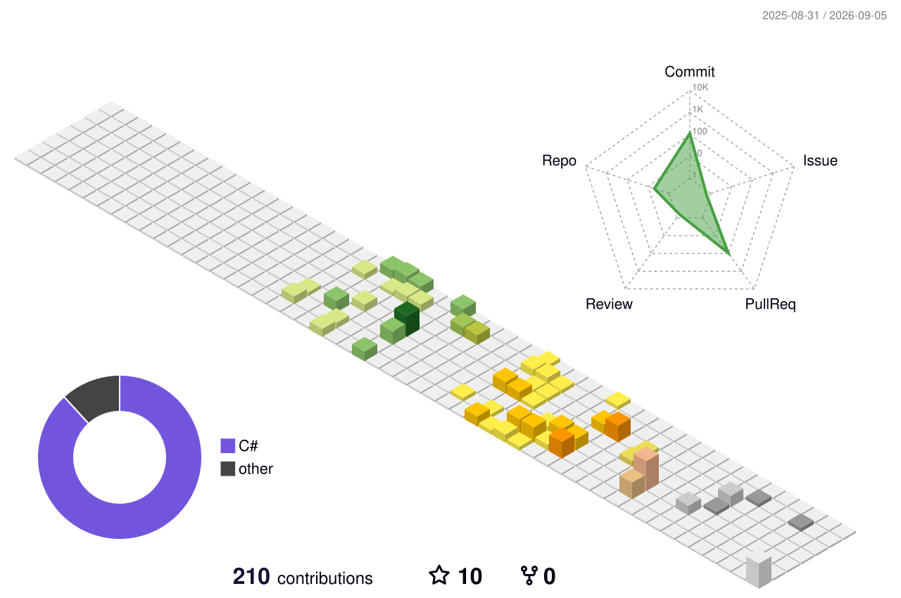

<h1 align="center">Hi 👋, I'm Hoai Phuc</h1>
<h3 align="center">Software Engineering</h3>

  

  
  

---

**Languages**

  
  
  

**Frameworks**

  
  
  
  

**Database**

  
  
  

**DevOps**

  
  
  

**Coding Tools**

  
  
  
  

---

### Contributions

  

---

